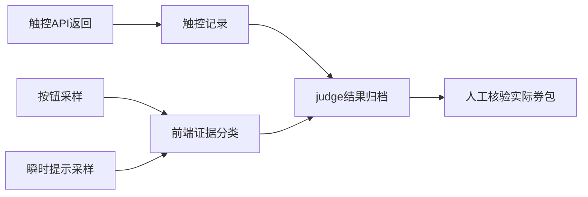

# 架构与关键函数

## 单文件核心与独立执行器

`shangou.js` 同时包含核心函数和E4X控制界面。核心位于 `var UI_OK = true;` 标记之前。`startDaemonWorker()` 在运行目录生成 `shangou-daemon.js`，该文件读取主文件的核心部分，设置 `HAS_UI=false`、加载配置并执行 `daemonLoop()`。

独立执行器由AutoX脚本服务持有，不依附控制界面Activity；这是v7对控制页被系统清理后守候一起结束问题的修复。两者共享磁盘配置与心跳文件，不共享JavaScript全局变量。控制页通过 `engines.all()` 查找指定执行器，停止时只终止对应路径。

生成文件会加载当前主文件，升级时必须先停止旧执行器。单纯替换磁盘源码不会让已运行的核心自动更新。

## 每场的时序

| 时点 | 责任 |
|---|---|
| T−9分钟 | `daemonLoop()` 进入本场调度，随后静默等待 |
| 约T−5分钟 | `runSession()` 再次对时、确认或恢复活动页 |
| T−3分钟 | `doFire()` 调用 `lockTargetSession()`，必要时重选场次 |
| T−30秒 | 复核按钮仍对应目标场次 |
| 约T−10秒 | 页面锚点、目标按钮与坐标校验 |
| T−3秒 | 最后检查按钮区域和前台 |
| T到T+10秒 | 默认timerBurst限时触控，同时观察页面 |
| 触控结束后 | 复查业务文案和按钮，`judge()` 写入最新与独立结果 |

启动较晚时会改走同步锁场分支，不能假设所有提前检查都已执行。锁场失败时停止出手。配置中的 `fireWindowMs` 从目标整点计算，检测到按钮可抢较晚时不会顺延窗口。

## 时间模型

`syncTime()` 对配置中的时间源取样，保存偏移与RTT，选择往返时间最小的有效样本。预算默认5秒，原生OkHttp请求设独立总调用超时。校准时保存服务器epoch与Android `elapsedRealtime()` 锚点，后续 `now()` 用单调时间差推进，避免系统墙钟跳变。

最小RTT是一种估计方法，不能消除链路不对称，也不能证明时间源与领券后端完全同步。首次触控“整点+0.5ms”是相对脚本校准时钟的本地调用时刻，不是服务端收到请求的时刻。

## 页面、前台与按钮

`foregroundPackage()` 优先读取无障碍服务的实时活动窗口。事件缓存的 `currentPackage()` 曾在实际桌面上仍返回旧App包名，因此导航不能仅依赖它。有服务但取不到窗口、或服务失联时拒绝放行。

`inActivityPage()` 检查前台与页面关键词。`launchAppForeground()` 指定明确Launcher组件，并在等待后验证前台；启动API正常返回不算成功。`tapHomeEntry()` 逐个尝试样例坐标并验证是否进入活动页。`dismissPopup()` 在读节点、点节点及尝试坐标前检查前台。

`inTargetZone()` 隔离券按钮区域与场次标签。`blindTapReady()` 检查页面锚点，但锚点缺失或偏移当前只输出警告，调用方仍继续按钮几何预检，并非硬停止条件。`preClickCheck()` 复核目标按钮边界等条件。首页入口仍依赖坐标；同一App内的页面判断仍依赖关键词，不能保证识别所有页面改版。

## 出手与观察分离

`timerBurst` 完成检查后等待整点，循环执行 `press(x,y,10)`，每次返回后额外等待20ms；直到窗口结束、上限、停止、读到前台切出或手势失败。关键循环不逐次查按钮、不逐次写盘、不逐次输出日志。与导航路径不同，领取预检和热循环仍使用 `currentPackage()` 事件缓存，可能滞后于真实前台；本版没有将实时窗口查询加入逐次触控路径。

`observeFireFeedback()` 独立读取按钮与页面提示。配置250ms是额外轮询间隔，实际周期还包括检索耗时；真机最长轮次曾超过900ms。因此采样时刻不等于状态发生时刻。观察与触控分离不意味着系统资源竞争或H5内部处理延迟已消除。

其他保留模式：`readyBurst` 等首次读到可抢后开始连点；`state` 逐次读状态再决定；`blind` 为旧定时连点兼容分支。当前实测默认均为 `timerBurst`。

## 结果链路

`judge()` 将本地前置结果、触控数和业务文案汇总。`fired_no_confirm` 表示发生触控且未观察到成功确认。`serviceErrorCode:null`、`causeConfirmed:false` 明确表示没有后端错误码和确定根因。

通用成功关键词仍可能命中营销文字，不能直接当领取成功。实际券包中的同一张目标券才是后续必须核验的业务证据。

## 源码定位

| 责任 | 函数 |
|---|---|
| 配置 | `selfDir`、`loadCfg`、`saveCfg` |
| 时间 | `syncTime`、`readServerTimeBody`、`now`、`sleepUntil` |
| 页面恢复 | `foregroundPackage`、`launchAppForeground`、`bringUpApp` |
| 场次 | `nextSession`、`forceSelectSession`、`lockTargetSession` |
| 出手 | `doFire`、`tapAt`、`preClickCheck` |
| 证据 | `observeFireFeedback`、`summarizePageEvidence`、`judge` |
| 生命周期 | `daemonLoop`、`startDaemonWorker`、`anotherInstanceAlive`、`actRun`、`actStop` |

测试与修改约束见[开发说明](DEVELOPMENT.md)。
