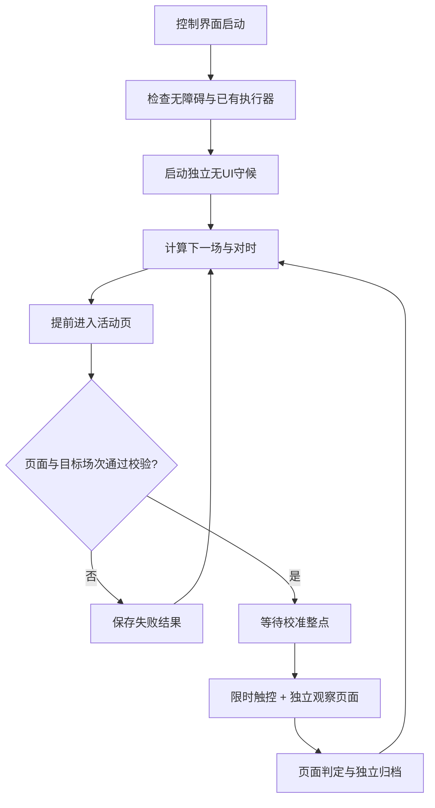

# shangou-android

在 Android 手机上独立运行的 AutoX.js 定时触控与诊断项目。当前场景为淘宝闪购“开学季限时抢”满18减18券：提前进场、校验场次与坐标、对时、到点触控，并保存能回查的页面证据。

## 项目状态与作者观点

**作者认为，这是一个很好的实现思路，经由进一步优化，可以达到自己预期的“完美使用”状态。** 手机独立守候、定时调度、触控与诊断分离，是本项目希望继续完善的方向。

**目前因时间原因暂时搁置。** 仓库保留完整源码、开发逻辑、测试方法与实测记录，供后续恢复开发和继续优化。上述为作者对后续优化的判断与目标，当前版本已实现的功能和验证范围见下文。

当前实测记录：2026-10-19的14、17、18、20点四场都执行了触控，均没有成功确认。已经验证的能力包括进场、场次校验、定时触控、独立守候和结果归档；触控成功不代表请求成功，更不代表领到券。

## 当前版本

| 项目 | 状态 |
|---|---|
| 开发状态 | 因时间原因暂时搁置，保留后续优化空间 |
| 源码构建 | `codex-20261019-recovery-7.1` |
| 手机运行环境 | 实测 AutoX.js v7 / Android 10 / 1080×2340 |
| 默认执行模式 | `timerBurst`，校准整点启动 |
| 触控窗口 | 整点后10秒，短按10ms，返回后再等20ms |
| 本地回归 | 63项，通过虚拟时钟验证关键行为 |
| 真机进场 | 从桌面22.173秒；App冷启动38.402秒，两次均进入目标页 |
| 实际领取结果 | 未确认成功，实际领取接口错误码尚未取得 |

## 功能与边界

- **独立守候**：控制界面启动无UI执行器，关闭控制界面后继续运行；无需电脑持续连接。清理整个AutoX服务、强制停止或重启后的恢复不在本次验证范围内。
- **进场恢复**：明确指定 `me.ele/.Launcher`，验证实时活动窗口包名；拉起失败及时退出。首页入口坐标仍受页面布局影响。
- **场次与区域校验**：提前锁定目标场次；后续复核按钮文案、锚点、按钮边界和前台，避免把场次标签当成领取按钮。
- **对时**：最多取3个样本，选最小RTT有效样本；使用Android单调时钟维持校准。公共时间源与领券服务的开抢时钟不保证完全一致。
- **定时触控**：默认到校准整点直接开始短按；独立线程观察页面，触控循环不等待每次文字检索。
- **证据归档**：记录手势API结果、状态采样、瞬时提示、场次身份、构建号与独立结果文件；进场失败也会归档。
- **条件退出**：场次锁定失败、按钮几何预检失败、读到前台切出、手势失败或窗口到期时停止相应动作。触控热循环仍读事件缓存包名，切出检测可能滞后；页面锚点异常目前只警告。

## 运行流程



## 手机快速开始

1. 准备 AutoX.js v7，并在手机上完成应用登录、活动所需认证与授权。其他运行时尚未完整验证。
2. 将 `shangou.js` 和由 `config.example.json` 复制得到的 `config.json` 放到同一手机目录，建议统一使用 `/sdcard/shangou/`。
3. 根据手机分辨率和当前活动页面校准配置；仓库坐标只是1080×2340设备的历史样例，不能直接用于所有手机。
4. 在AutoX运行 `shangou.js`。首次确认无障碍服务可用，先打开目标活动页检查配置，再使用标定和守候操作。
5. 启动后，脚本生成 `shangou-daemon.js` 并由独立服务执行。自动启动路径会关闭控制界面；重新打开控制页可以停止守候。
6. 通过实际券包核验是否领到目标券。脚本的通用成功文案判定仍存在误判可能。

完整步骤见[安装与使用](docs/SETUP.md)，参数见[配置说明](docs/CONFIGURATION.md)。运行脚本不需要Node.js；Node仅用于电脑端开发检查。

## 开发与验证

开发检查使用 Node.js 20或更高版本，无第三方依赖：

```sh
npm test
npm run check
```

`npm test` 是离线虚拟时钟回归，不会连接手机或点击真实券。语法检查会先替换Node不支持的AutoX E4X界面块；它不能替代手机运行时编译与实际页面验证。GitHub Actions会在Linux和Windows执行这些检查。

## 项目结构

```text
shangou.js                 手机端完整源码，保留已部署v7.1版本
config.example.json        不含账号凭据的配置样例
regression.cjs             63项离线行为回归
scripts/                   语法、项目完整性与文档链接检查
examples/                  精简实测数据，无原始设备日志
docs/                      架构、配置、开发、实测与排障说明
.github/workflows/         持续集成检查
```

## 阅读路径

- 想使用：[安装与使用](docs/SETUP.md) → [配置说明](docs/CONFIGURATION.md) → [排障](docs/TROUBLESHOOTING.md)
- 想理解开发逻辑：[架构与关键函数](docs/ARCHITECTURE.md) → [设计决策](docs/DECISIONS.md)
- 想继续开发：[开发与验证](docs/DEVELOPMENT.md) → [贡献说明](CONTRIBUTING.md)
- 想判断实际效果：[实测与证据边界](docs/EVIDENCE.md) → [版本记录](CHANGELOG.md)

## 已知限制

页面坐标与业务规则会变化；“正在抢”只证明页面进入处理状态。“活动太火爆”不足以确定拥堵、库存或账号限制。观察线程在约10秒结束，结束后到最终按钮复查之间仍可能遗漏瞬时提示。实时窗口守卫目前覆盖导航路径，领取热循环仍可能受过期前台事件影响；锚点偏移不会直接硬停。目前没有实际领取接口返回码，也没有成功率结论。

代码保留部分早期策略注释，当前行为以 `config.json` 中的 `fireMode`、实际分支与本版文档为准。项目不包含账号Cookie、直接领取接口或多账号并发方案。使用前自行确认活动规则；仓库未指定开源许可证，`package.json` 标记为 `UNLICENSED`。
